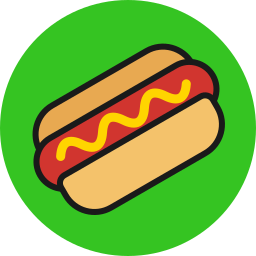
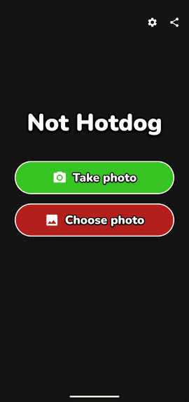
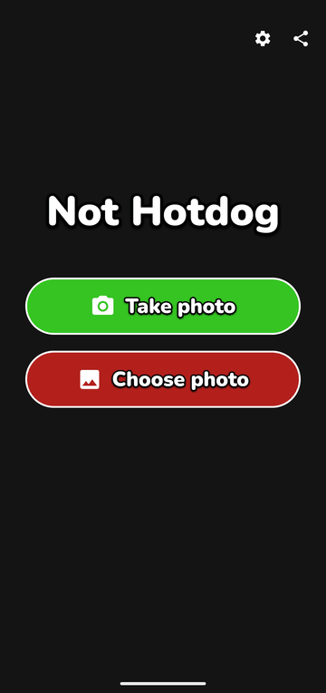
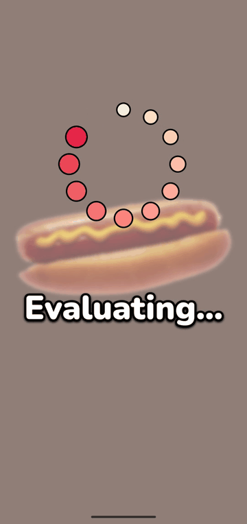
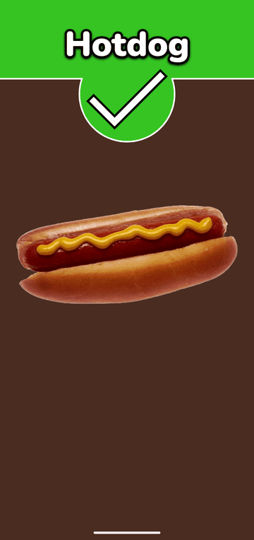
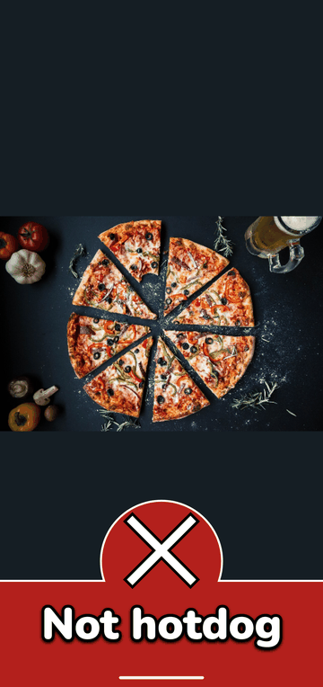
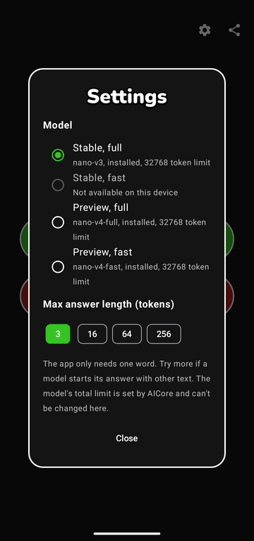
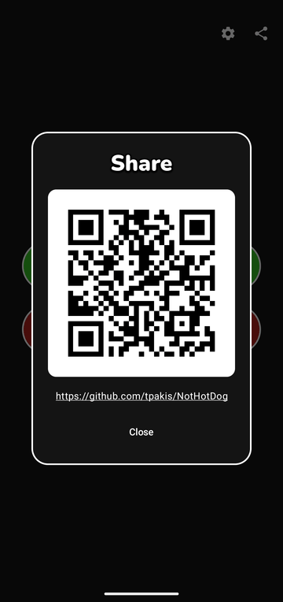

<p align="center">
  
</p>

<h1 align="center">Not Hotdog</h1>

<p align="center">
  <a href="https://developer.android.com"></a>
  <a href="https://kotlinlang.org"></a>
  <a href="https://developer.android.com/compose"></a>
  <a href="https://developer.android.com/ai/gemini-nano"></a>
  <a href="https://developers.google.com/ml-kit/genai/prompt/android"></a>
  <a href="LICENSE"></a>
</p>

An Android demo of the "Not Hotdog" app from the TV show *Silicon Valley*. Take or choose a photo and it tells you whether it's a hotdog, using Gemini Nano on the device.

It's an unofficial fan project with no connection to the show or its owners.

## Demo

<p align="center">
  
</p>

Recorded on a Pixel 10 with real on-device results. The GIF skips the step of choosing a photo.

## Screenshots

| Home | Evaluating | Hotdog |
|---|---|---|
|  |  |  |

| Not hotdog | Settings | Share |
|---|---|---|
|  |  |  |

Sample photos: [hot dog](https://commons.wikimedia.org/wiki/File:Hot_dog_with_mustard.png) by Renee Comet, National Cancer Institute (public domain), and [pizza](https://commons.wikimedia.org/wiki/File:Pizza-3007395.jpg) by igorovsyannykov (CC0).

## Getting started

```sh
./gradlew installDebug
```

Classification needs a device with Gemini Nano, such as a Pixel 9 or 10. Signed APKs are on the [releases page](https://github.com/tpakis/NotHotDog/releases).

## Documentation

See the [documentation](docs/README.md) for how the app works, its architecture, and how to work on it. Agents should also read [`AGENTS.md`](AGENTS.md).

## License

The code is available under the [MIT License](LICENSE). The bundled Nunito font is under the [SIL Open Font License](app/src/main/assets/licenses/nunito_OFL.txt). The license doesn't grant any rights to the show or its name.
