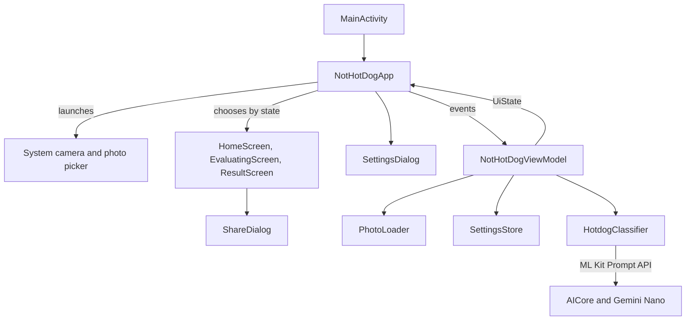

# Architecture

It is a single-module Compose app with one activity and one ViewModel. There's no navigation library, dependency injection or repository layer, because three screens and one data source don't need them. Add those only when the app outgrows this.

## Structure



## Files

Paths are under `app/src/main/java/ai/thanasakis/nothotdog/`.

| File | Responsibility |
|---|---|
| `MainActivity.kt` | Sets up edge-to-edge with light system bar icons and hosts the UI |
| `NotHotDogViewModel.kt` | Owns `UiState`, starts and cancels evaluations, owns the classifier and replaces it when the model changes |
| `SettingsStore.kt` | Saves the model choice and max answer length in `SharedPreferences` |
| `PhotoLoader.kt` | Decodes a `Uri` into an upright bitmap of at most 2048 px per side |
| `classifier/HotdogClassifier.kt` | Availability, download, the prompt, answer parsing |
| `classifier/ModelChoice.kt` | The model variants, creating a client for one, and probing what the device offers |
| `ui/NotHotDogApp.kt` | Activity result launchers, back handling, switching between screens |
| `ui/HomeScreen.kt` | Home screen and model status |
| `ui/EvaluatingScreen.kt` | Washed-out photo and dot spinner |
| `ui/ResultScreen.kt` | Banner, badge, check mark and X |
| `ui/ShareDialog.kt` | Share dialog and QR code generation |
| `ui/SettingsDialog.kt` | Model picker and max answer length |
| `ui/OutlinedText.kt` | The white, black-outlined lettering used across the app. Only the fill is exposed to accessibility services |
| `ui/Previews.kt` | Compose previews of each screen |
| `ui/theme/` | Brand colors in `Color.kt`, the font in `Type.kt`, and template Material theming |

## State

`NotHotDogViewModel.uiState` is the single source of truth. It's Compose state, so screens read it directly.

```kotlin
data class UiState(
    val model: ModelState,       // Checking, Downloading, Ready or Unavailable
    val screen: Screen,          // Home, Evaluating(photo) or Result(photo, isHotdog)
    @StringRes val message: Int?, // the last error, shown on the home screen
    val selectedModel: ModelChoice,
    val modelChoices: List<ModelChoiceInfo>?, // null while the settings dialog is checking
    val maxOutputTokens: Int,
)
```

`NotHotDogApp` picks the composable with a `when` on `screen`. A screen is a state value and not a navigation destination, so the back stack is just `BackHandler` calling `backToHome()`.

## What happens during an evaluation

1. The launcher in `NotHotDogApp` returns a `Uri` and calls `viewModel.evaluate(uri)`.
2. `PhotoLoader` decodes the photo on `Dispatchers.IO`. Home stays visible during this step.
3. The state moves to `Screen.Evaluating`.
4. `HotdogClassifier.isHotdog` suspends while Gemini Nano answers.
5. The state moves to `Screen.Result`. On any exception other than cancellation, it moves to `Screen.Home` with a message.

Back and starting a new evaluation both cancel the job in `evaluation`, which is why `CancellationException` is rethrown rather than reported as a failure.

## Lifecycle

| Event | What happens |
|---|---|
| Rotation or other configuration change | The ViewModel survives, including a running evaluation and its bitmaps |
| Process death | `UiState` isn't saved, so the app restarts on home |
| Process death while in the camera | `pendingCapture` is a `rememberSaveable`, so the result can still be handled |
| Model changed in settings | The running check and evaluation are cancelled, the old client is closed and a new one is created |
| ViewModel cleared | `onCleared` closes the `GenerativeModel` |

## Decisions worth knowing

- **System camera, not CameraX.** The brief asked for a button that takes a photo, and this needs no permission or camera code. The show seems to use an in-app viewfinder, so CameraX is the change to make for a closer match. Declaring the `CAMERA` permission also makes `TakePicture` require it at runtime.
- **Captures go in `filesDir/photos`, not the cache.**  Backup rules exclude this folder so that snapshots don't reach cloud backup, and each capture overwrites `capture.jpg`.
- **Two image sizes.** The screen gets up to 2048 px and the model up to 1024 px.
- **Plain prompt, not structured output.** Structured output needs KSP and a schema to return one yes or no. See [On-device inference](on-device-inference.md).
- **ZXing `core` for the QR code.** It's pure Java with no Android dependencies. The bitmap is drawn at one pixel per module and scaled with nearest-neighbour filtering, so the code stays sharp.

## Known limitations

- A failed camera capture shows no message, because `TakePicture` reports it the same way as a cancel.
- The blur on the evaluating screen only renders on Android 12 and later. `Modifier.blur` does nothing on older versions, though those are unlikely to run Gemini Nano anyway.
- `PhotoLoader` uses the platform `ExifInterface`, which lint flags in favour of the AndroidX one.
- `colors.xml` and `Theme.kt` still contain unused Android Studio template values.
