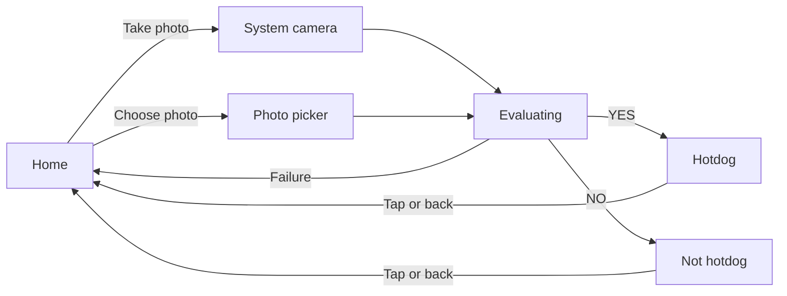

# How the app works

## The flow

## Screens

### Home

The title, **Take photo**, **Choose photo**, and settings and share icons at the top right. This screen isn't from the show, which never shows one.

The photo buttons are enabled only once the model is ready. Until then, a status line under them shows one of these:

| Model state | What the user sees |
|---|---|
| Checking | "Checking on-device AI…" |
| Downloading | "Downloading on-device AI model…", with a percentage once the size is known |
| Ready | Nothing, and the buttons are enabled |
| Unavailable | "Gemini Nano isn't available on this device." and a **Check again** button |

The same line shows errors from the last attempt, such as "Couldn't evaluate that photo. Try again."

### Taking or choosing a photo

**Take photo** opens the system camera through `ActivityResultContracts.TakePicture`, so the app doesn't need the `CAMERA` permission. Cancelling, or a capture the camera couldn't save, returns to the home screen with no message.

**Choose photo** opens the Android photo picker, which needs no storage permission and gives the app access only to the chosen image.

### Evaluating

The photo fills the screen, slightly blurred and washed out, with a rotating ring of dots and "Evaluating...". Pressing back cancels the request and returns home.

### Result

A hard cut from the spinner, with no transition, because that is how it looks in the show.

- **Hotdog:** a green banner at the top with a badge and check mark.
- **Not hotdog:** a red banner at the bottom with a badge and X.

The app shows only the verdict and never the model's reasoning. Tapping anywhere or pressing back returns home.

If the model fails or gives an answer other than yes or no, the app goes back home with an error. It doesn't fall back to "Not hotdog", because that would present a failure as a verdict.

### Settings

The settings icon opens a dialog with two options, and both are remembered between launches:

- **Model:** the four variants the device can be asked for, each showing its model name and token limit if installed. Selecting one that isn't installed downloads it, and variants the device doesn't offer are disabled.
- **Max answer length:** 3, 16, 64 or 256 tokens. The default of 3 is enough for the one-word answer.

The model's total token limit is shown but can't be changed, because the API doesn't allow it. See [On-device inference](on-device-inference.md#choosing-a-model).

### Share

The share icon opens a dialog with a QR code and a tappable link to <https://github.com/tpakis/NotHotDog>. It works on every device, including those without Gemini Nano. The QR code is generated on the device, so it works offline.
